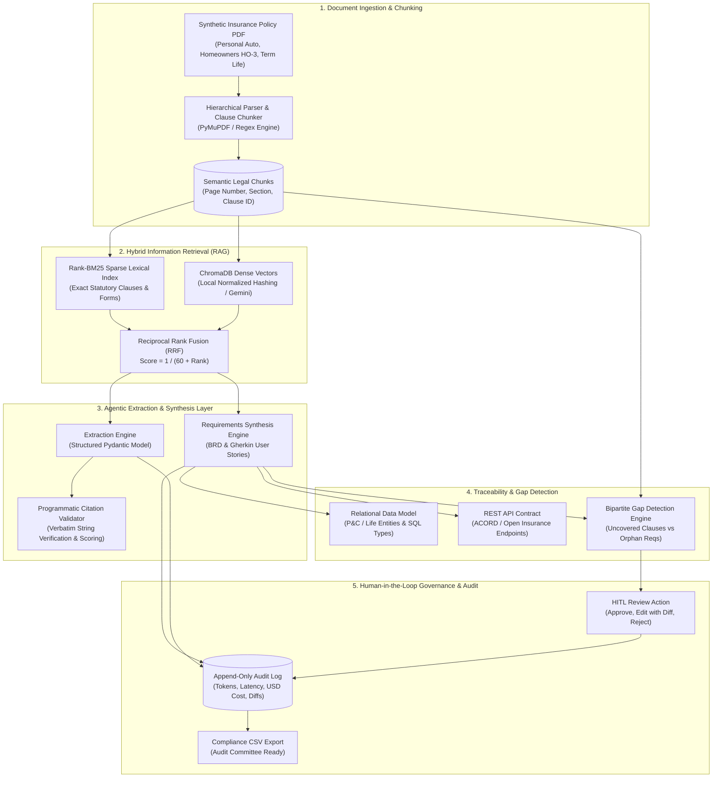
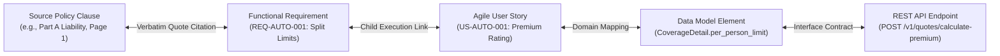

# Insurance Requirements Agent

[](https://github.com/swapnika-456/insurance-requirements-agent)
[](https://github.com/swapnika-456/insurance-requirements-agent)
[](https://fastapi.tiangolo.com)
[](https://docs.pydantic.dev)
[](https://www.trychroma.com)
[](LICENSE)

> **Enterprise Agentic AI system that ingests insurance policy forms, extracts structured actuarial specifications with verbatim source citations, generates Jira-ready User Stories with Gherkin acceptance criteria, synthesizes relational Data Models and REST API contracts, enforces bidirectional Traceability with automated Gap Detection, and provides Human-in-the-Loop governance with an append-only audit trail.**

---

## 1. Executive Summary & Business Vision

In property & casualty (P&C) and life insurance carriers, introducing a new insurance product or migrating policy administration to modern core systems (e.g., **Guidewire PolicyCenter**, **Duck Creek**, or proprietary insurtech platforms) represents a massive operational bottleneck. 

Under traditional workflows:
- Systems engineers and business analysts manually review 50-to-150 page legal forms filed with state **Departments of Insurance (DOI)**.
- Translation of statutory language into software specifications takes **3 to 9 months per product**.
- Critical underwriting covenants or state-mandated endorsements are frequently overlooked, leading to **uncovered statutory clause risks** or **unfiled rogue features (orphan requirements)** that incur millions of dollars in regulatory market conduct fines.

The **Insurance Requirements Agent** eliminates this operational hazard through a deterministic, citation-grounded multi-agent pipeline modeled after carrier-grade AI architectures.

---

## 2. System Architecture



### The Bidirectional Traceability Graph
To de-risk state filings and software delivery, the system builds an interconnected, navigable bipartite graph:



---

## 3. Technology Stack

| Component | Technology | Rationale & Enterprise Role |
| :--- | :--- | :--- |
| **Backend Framework** | **Python 3.12 + FastAPI** | High-performance asynchronous execution (ASGI), automatic OpenAPI documentation, clean dependency injection. |
| **Data Validation** | **Pydantic v2** | Strict schema validation ensuring 100% deterministic JSON output from LLMs without runtime type failures. |
| **Relational Database** | **SQLite + SQLAlchemy 2.0** | Relational source of truth for documents, section chunks, requirements, and immutable audit logs. |
| **Vector Database** | **ChromaDB** | Vector similarity engine for dense semantic search. |
| **Lexical Search** | **Rank-BM25 (Okapi)** | Sparse lexical search catching exact statutory codes, endorsement IDs, and deductible clauses. |
| **PDF Ingestion** | **PyMuPDF (Fitz) + ReportLab** | Structural PDF page extraction; synthetic ISO policy generator with two-pass header/footer counters. |
| **LLM Provider** | **Gemini 2.5 Flash / MockLLM** | Pluggable provider abstraction with exponential backoff, prompt caching, and cost accounting. |
| **Frontend Framework** | **Flutter (Web & Desktop/Mobile)** | Cross-platform client with Riverpod state management, Dio networking, GoRouter navigation, and Material 3 design. |
| **Evaluation Suite** | **Python Eval Harness** | Grounded benchmark against `eval/golden_set.json` testing extraction, citation, coverage, and hallucination resistance. |

---

## 4. Domain Glossary

- **Declarations Page (Dec Schedule):** The summary front page of an insurance policy specifying named insureds, effective periods, covered assets, rating factors, limits, and deductibles.
- **Endorsement (Rider):** A formal written amendment attached to a baseline policy form that adds, deletes, or modifies coverage terms (e.g., Rideshare Extension, Water Backup).
- **Split Limits (e.g., 250/500/100):** A common P&C auto structure defining \$250,000 bodily injury per person, \$500,000 bodily injury per accident, and \$100,000 property damage per accident.
- **Deductible vs. Retention:** The initial out-of-pocket loss borne by the policyholder before the carrier indemnifies the claim.
- **Replacement Cost Value (RCV) vs. Actual Cash Value (ACV):** RCV reimburses repair/replacement at current market prices without depreciation; ACV subtracts depreciation based on age and wear.
- **Uncovered Clause Risk:** A statutory clause present in the filed policy document that has zero mapped software requirements (a potential compliance blindspot).
- **Orphan Requirement Risk:** A software requirement created by an engineer or LLM that has no grounding citation in an approved policy document (potential hallucination or unfiled rogue feature).
- **Incontestability & Suicide Clause:** Statutory provision in life insurance limiting the carrier's ability to contest coverage or void policy for misstatements or suicide after 2 policy years.

---

## 5. Getting Started & Installation

### Prerequisites
- **Python:** 3.12 or higher
- **Flutter SDK:** 3.19 or higher
- **Git:** Standard CLI

### 1. Clone the Repository
```bash
git clone https://github.com/swapnika-456/insurance-requirements-agent.git
cd insurance-requirements-agent
```

### 2. Backend Setup
```bash
# Create and activate virtual environment
python -m venv .venv
# Windows:
.venv\Scripts\activate
# Linux/macOS:
source .venv/bin/activate

# Install dependencies
pip install -r backend/requirements.txt

# Configure environment variables
copy .env.example .env

# (Optional) Add your Gemini API Key in .env to use live Gemini 2.5 Flash
# GEMINI_API_KEY=your_key_here
```

### 3. Generate Benchmark Synthetic Policy Forms
```bash
python samples/generate_samples.py
```
This generates three carrier-grade synthetic PDFs in `samples/`:
1. `sample_auto_policy.pdf` (Personal Auto Policy PA-2026-OH)
2. `sample_homeowners_policy.pdf` (Homeowners HO-3 Special Form HO3-2026-TX)
3. `sample_term_life_spec.pdf` (20-Year Level Term Life Spec TL-2026-IL)

### 4. Launch Backend API Server
```bash
python -m uvicorn app.main:app --reload --port 8000
```
- **API Swagger Documentation:** `http://localhost:8000/docs`
- **ReDoc Interactive Spec:** `http://localhost:8000/redoc`
- **Health Probe:** `http://localhost:8000/health`

### 5. Launch Flutter Web Application
In a separate terminal:
```bash
cd mobile
flutter pub get
flutter run -d chrome
```

---

## 6. Running Tests & Automated Evaluation

### Execute Full Backend Test Suite (Pytest)
```bash
python -m pytest backend/tests/ -v
```
All **19 tests** cover:
- PDF Ingestion, validation, and hierarchical clause chunking
- LLM Provider fallback, cost calculation, and exponential backoff
- Programmatic citation quote verification and confidence scoring
- Hybrid RAG (ChromaDB dense vectors + BM25 sparse lexical matching with RRF)
- BRD and Agile User Story generation with Gherkin acceptance criteria
- Bipartite Traceability Matrix synthesis, gap detection, and CSV export
- Human-in-the-Loop review actions (Approve, Edit with diff, Reject)
- Append-only compliance audit trail and cascading document deletion

### Execute Frontend Widget Tests (Flutter)
```bash
cd mobile
flutter test
```

### Execute Evaluation Benchmark Harness
```bash
python eval/run_eval.py
```
Evaluates the pipeline against `eval/golden_set.json` (40 extractions, 25 requirements, 10 negative test cases) and saves the scorecard report to `eval/results.md`.

---

## 7. Deliverables Summary (Phases 1 to 6)

| Phase | Core Deliverable | Technical Highlights | Documentation |
| :---: | :--- | :--- | :--- |
| **Phase 1** | **Ingestion & Clause Chunker** | ReportLab synthetic PDF generator; PyMuPDF hierarchical clause parser with OCR fallback; SQLite models; REST endpoints. | [`docs/phase-1-recap.md`](docs/phase-1-recap.md) |
| **Phase 2** | **Structured Extraction & Citations** | Pluggable LLM interface; Gemini 2.5 Flash + MockLLM; Programmatic verbatim citation validator; Real-time cost accounting. | [`docs/phase-2-recap.md`](docs/phase-2-recap.md) |
| **Phase 3** | **Hybrid RAG & Requirements Synthesis** | ChromaDB + BM25 Okapi with Reciprocal Rank Fusion (RRF); BRD generator; User Stories with Gherkin BDD criteria; Flutter UI. | [`docs/phase-3-recap.md`](docs/phase-3-recap.md) |
| **Phase 4** | **Data Model, API Contract & Traceability** | LOB-specific relational Data Model; REST API Contract (ACORD); Bipartite Gap Detection (uncovered clauses vs orphan reqs); CSV export. | [`docs/phase-4-recap.md`](docs/phase-4-recap.md) |
| **Phase 5** | **HITL Review, Audit Log & Cost Governance** | Reviewer Approve/Edit/Reject engine; Immutable append-only `audit_logs` table; Real-time cost dashboard; Cascading document purge. | [`docs/phase-5-recap.md`](docs/phase-5-recap.md) |
| **Phase 6** | **Eval Harness, Golden Set & Benchmark** | 75-item Golden Set (`eval/golden_set.json`); Automated eval runner (`eval/run_eval.py`); Markdown scorecard (`eval/results.md`). | [`docs/phase-6-recap.md`](docs/phase-6-recap.md) |

---

## 8. Honest Engineering Checklist: Production vs. MVP Simplifications

| Architectural Area | Implemented in This System | Production Enterprise Scale |
| :--- | :--- | :--- |
| **Input Documents** | High-fidelity synthetic PDFs generated via ReportLab with consistent layout structures. | Scanned multi-column legacy TIFF/PDFs with OCR noise, handwriting, and rotated stamp endorsements. |
| **Vector Embeddings** | Deterministic 128-dimensional local normalized token hashing (`FastLocalEmbeddingFunction`) for instant zero-dependency execution. | High-dimensional dense embeddings (`text-embedding-004` or `text-embedding-3-large`) with semantic chunk chunking. |
| **Lexical Search** | In-memory `rank-bm25` (Okapi) index per document. | Clustered Elasticsearch or OpenSearch cluster with statutory insurance tokenizers and synonym expansion. |
| **Relational Storage** | Local SQLite database via SQLAlchemy with foreign-key cascade definitions. | High-availability PostgreSQL database with `pgvector` extension and row-level security (RLS). |
| **Audit Log Storage** | Local append-only SQLite `audit_logs` table with snapshot schema preservation. | Write-Once-Read-Many (WORM) storage (e.g., AWS S3 Glacier Object Lock) cryptographically hashed with SHA-256 for compliance audits. |
| **Core Admin Integration** | Standard OpenAPI REST contracts and exportable CSV matrices. | Direct Guidewire Gosu / Edge API connectors or ACORD XML/JSON messaging buses. |

---

## 9. License

This project is licensed under the MIT License. See [LICENSE](LICENSE) for details.
